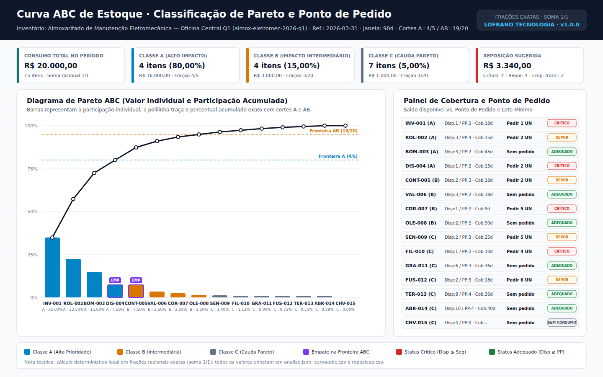

# Curva ABC de Estoque

Classifique itens pela Curva ABC de Pareto e calcule cobertura em dias, estoque de segurança, ponto de pedido e lote mínimo de compra com frações racionais exatas e memória de cálculo auditável. O **Curva ABC de Estoque** ordena o inventário pelo valor de consumo em centavos inteiros, calcula participações individuais e acumuladas cuja soma fecha exatamente em `1/1` (`fractions.Fraction`), sinaliza empates de valor e empates sobre as fronteiras de classe (`empate_valor` e `empate_fronteira`) e dimensiona pedidos de reposição sem ponto flutuante.

CLI e biblioteca Python da [LOFRANO TECNOLOGIA](https://lofranotecnologia.com.br/), em português, sob [licença MIT](LICENSE). O motor utiliza exclusivamente a biblioteca padrão do Python (3.11+): não usa rede, banco remoto, serviços externos nem dependências de terceiros em tempo de execução.



## Experimentar

Requer Python 3.11 ou posterior. Crie um ambiente virtual e instale o pacote local:

```sh
git clone https://github.com/martinlofranodeoliveira/curva-abc-estoque.git
cd curva-abc-estoque
python -m venv .venv
```

No Linux/macOS:

```sh
.venv/bin/python -m pip install .
.venv/bin/curva-abc-estoque exemplo --saida exemplo-curva-abc.zip
```

No Windows:

```powershell
.venv\Scripts\python -m pip install .
.venv\Scripts\curva-abc-estoque exemplo --saida exemplo-curva-abc.zip
```

A [versão 1.0.0](https://github.com/martinlofranodeoliveira/curva-abc-estoque/releases/tag/v1.0.0) oferece wheel, código-fonte (`sdist`), pacote ZIP do exemplo sintético (`exemplo-curva-abc.zip`), imagem de referência (`exemplo.png`) e manifesto `SHA256SUMS`.

Descompacte `exemplo-curva-abc.zip` e abra `curva-pareto.svg`, `RELATORIO.md` e `LEIA-ME.md`. O cenário sintético avalia 15 itens de almoxarifado eletromecânico em uma janela de 90 dias (consumo total de `R$ 20.000,00`): 4 itens na Classe A (`4/5` = 80,00% do valor), 4 na Classe B (`3/20` = 15,00%) e 7 na Classe C (`1/20` = 5,00%), incluindo um par com empate exato de valor (`R$ 1.500,00`) sobre a fronteira A/B (`DIS-004` em A e `CONT-005` em B) e os quatro estados operacionais (`critico`, `repor`, `adequado` e `sem_consumo`).

## Analisar seus arquivos

```sh
curva-abc-estoque analisar entrada.json --saida resultado.zip
```

O documento de entrada segue o esquema `schema_version: 1` detalhado em [FORMATO.md](docs/FORMATO.md) e na [API Python](docs/API.md). O pacote ZIP gerado contém oito arquivos em ordem lexicográfica fixa:

| Arquivo no ZIP | Conteúdo |
| --- | --- |
| `LEIA-ME.md` | Guia rápido de leitura dos arquivos e limites do pacote |
| `RELATORIO.md` | Relatório textual auditável em português com tabelas e aviso de escopo técnico |
| `SHA256SUMS` | Hashes SHA-256 dos outros sete arquivos do pacote |
| `analise.json` | Memória de cálculo estruturada por classe ABC e item ordenado |
| `curva-abc.csv` | Tabela ABC de Pareto em UTF-8 (LF) com proteção contra injeção de fórmulas |
| `curva-pareto.svg` | Painel visual estático (1440×900) da curva de Pareto e cobertura de reposição |
| `entrada.json` | Bytes originais exatos da entrada analisada |
| `reposicao.csv` | Tabela operacional de cobertura, ponto de pedido, lote mínimo e pedido sugerido |

Um caminho de saída já existente (arquivo ou symlink) nunca é sobrescrito: a publicação prepara um temporário no mesmo diretório e faz vínculo atômico exclusivo via `os.link`.

## Regras de cálculo e reposição

1. **Classificação ABC de Pareto com frações exatas (`fractions.Fraction`)**:
   - Cada item tem `valor_consumo_centavos = consumo_periodo * custo_unitario_centavos`.
   - A ordenação é estritamente determinística por `(-valor_consumo_centavos, -custo_unitario_centavos, codigo)`.
   - A participação individual `valor_consumo_centavos / valor_consumo_total_centavos` e a acumulada são frações reduzidas exatas cuja soma total fecha em `1/1`.
   - Itens com `consumo_periodo == 0` recebem classe `"C"`. Os demais recebem `"A"` quando `participacao_acumulada <= limite_a` (ou na posição `1`), `"B"` quando `limite_a < participacao_acumulada <= limite_ab` e `"C"` acima de `limite_ab`.
   - Quando dois ou mais itens têm o mesmo `valor_consumo_centavos`, recebem `empate_valor: true`; se o corte acumulado dividir o grupo empatado em classes ABC distintas, recebem também `empate_fronteira: true`.
2. **Estoque de segurança, ponto de pedido, cobertura e lote mínimo**:
   - `estoque_disponivel = estoque_atual + estoque_em_transito`
   - `estoque_seguranca = ceil((consumo_periodo * dias_seguranca) / dias_analise)`
   - `demanda_lead_time = ceil((consumo_periodo * lead_time_dias) / dias_analise)`
   - `ponto_pedido = demanda_lead_time + estoque_seguranca`
   - `cobertura_dias_racional = (estoque_disponivel * dias_analise) / consumo_periodo` (`null` quando `consumo_periodo == 0`)
   - Status de reposição: `"sem_consumo"` (`consumo_periodo == 0`), `"critico"` (`estoque_disponivel <= estoque_seguranca`), `"repor"` (`estoque_seguranca < estoque_disponivel < ponto_pedido`) ou `"adequado"` (`estoque_disponivel >= ponto_pedido`).
   - Para itens em `"critico"` ou `"repor"`, `deficit_unidades = ponto_pedido - estoque_disponivel`, `lotes_sugeridos = ceil(deficit_unidades / lote_minimo)` e `pedido_sugerido_unidades = lotes_sugeridos * lote_minimo`.

> **Aviso de escopo técnico:** esta ferramenta executa cálculo aritmético determinístico sobre saldos, consumos e parâmetros fornecidos na entrada. Não substitui contagem física de estoque, auditoria contábil ou previsão estatística de demanda.

## Desenvolver e conferir

```sh
python -m pip install . -r requirements-build.txt
python -m unittest discover -s tests -v
python -m build
python scripts/check_distribution.py --dist dist
python tools/verify_independent.py
```

O verificador independente em [INTEROPERABILIDADE.md](docs/INTEROPERABILIDADE.md) revalida pacotes ZIP sem importar `curva_abc_estoque`, utilizando `fractions.Fraction` e consultas SQL em `sqlite3`. Os procedimentos de empacotamento e conferência de release estão em [VERIFICACAO.md](docs/VERIFICACAO.md).
